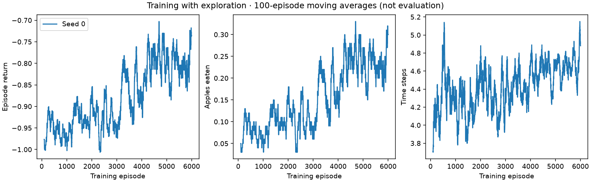
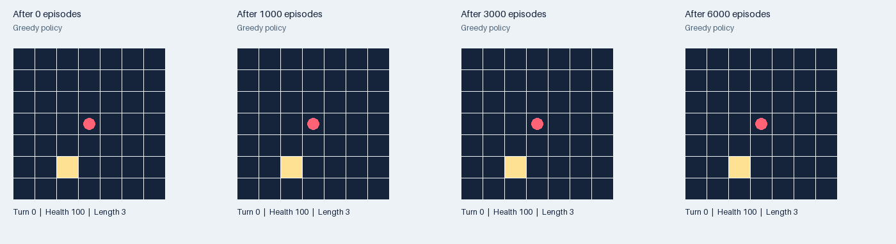
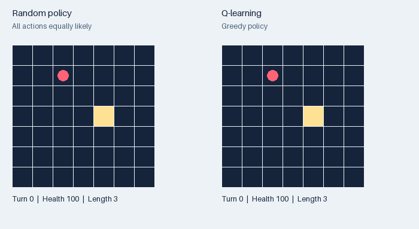
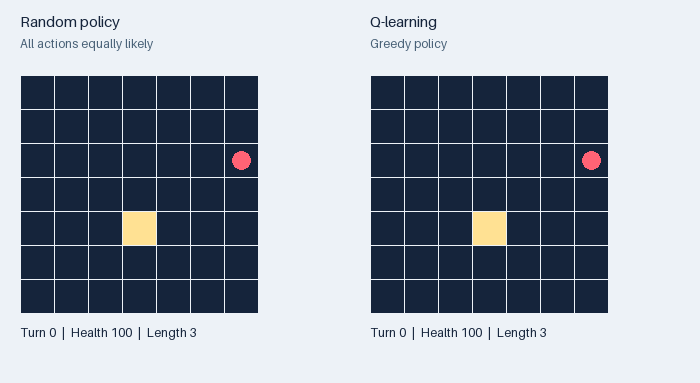
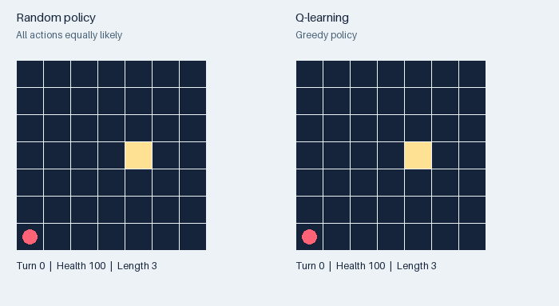

# Your evaluation

100 held-out environment seeds per policy; epsilon=0; no updates.
The same reset seeds are used for every policy; later food layouts can diverge when actions differ.

| Policy | Training seed | Mean return | Mean apples | Mean steps | At time limit |
|---|---:|---:|---:|---:|---:|
| Q-learning | 0 | -0.90 | 0.13 | 4.2 | 0.0% |
| Random | -1 | -0.99 | 0.04 | 4.3 | 0.0% |

Training curves include exploration; evaluation results do not. Survival is capped at 250 turns. A time limit is not a win or a death. The compact state merges different board situations, so optimal-policy guarantees for a full finite MDP do not apply directly.

